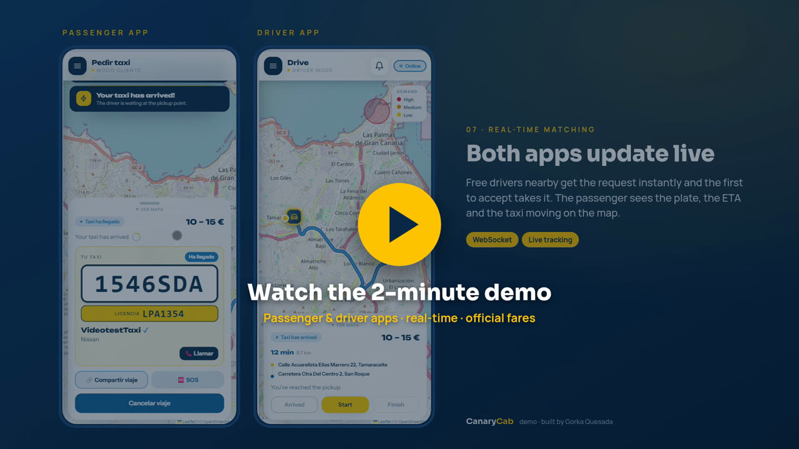
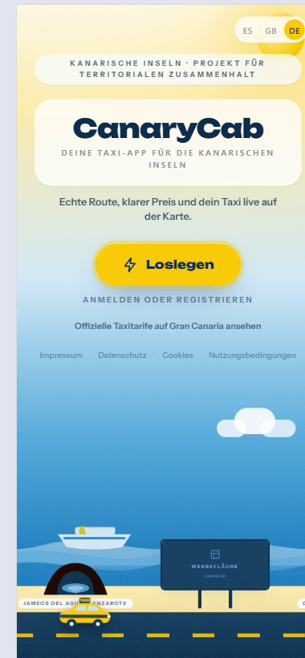
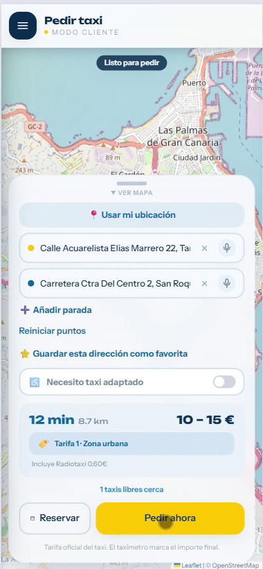
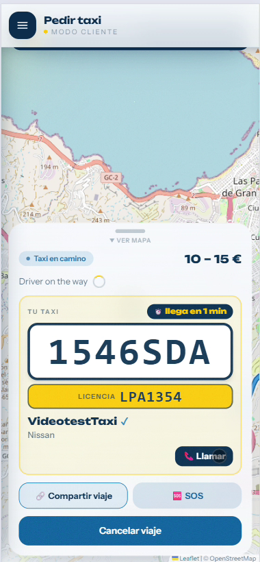
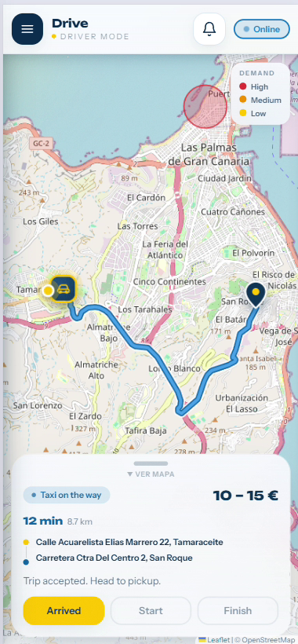
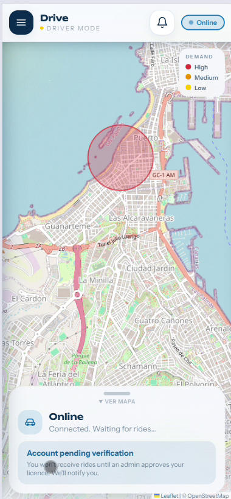

<div align="center">

# 🚕 CanaryCab

### A real-time taxi app for Gran Canaria

Book a taxi, see the real street route and the official fare before you ride, and follow your driver live.
Passenger, driver and admin apps, with fares calculated from the Las Palmas de Gran Canaria taxi ordinance (BOC nº 150, 2023).


<br>

<a href="https://drive.google.com/file/d/1UtCLmMCiPFVPNWl5038WYH29aiRMssLB/view?usp=sharing">
  
</a>

**[▶ Watch the 2-minute demo](https://drive.google.com/file/d/1UtCLmMCiPFVPNWl5038WYH29aiRMssLB/view?usp=sharing)**

</div>

> **Status:** CanaryCab ran in production at canarycab.com from summer to October 2026.
> It is currently offline to save hosting costs. The demo video was recorded on the live deployment,
> and the app can be run locally in a few minutes (see [Run it locally](#-run-it-locally)).

---

## 👋 About the project

I designed and built CanaryCab on my own between June and September 2026, from the database to the
mobile screens, using Claude Code as an AI pair programmer. The goal was a taxi app that fits Gran Canaria:
official local fares, airport transfers, island excursions and the way local drivers actually work.

**Author:** Gorka Jesús Quesada Vega ·
[Portfolio](https://gorka-quesada.vercel.app) ·
[LinkedIn](https://www.linkedin.com/in/gorka-quesada-vega-1678a1427) ·
[GitHub](https://github.com/gorkajesusquesadavegadev-ui)

---

## 📱 Screenshots

<div align="center">
<table>
  <tr>
    <td align="center"><br/><sub><b>Landing (EN / ES / DE)</b></sub></td>
    <td align="center"><br/><sub><b>Book · route and fare</b></sub></td>
    <td align="center"><br/><sub><b>Passenger · taxi on the way</b></sub></td>
  </tr>
  <tr>
    <td align="center"><br/><sub><b>Driver · trip in progress</b></sub></td>
    <td align="center"><br/><sub><b>Driver · demand map</b></sub></td>
    <td align="center"><br/><sub><b>Fixed-price transfers</b></sub></td>
  </tr>
</table>
</div>

---

## ✨ Features

### Passenger
- **Book a taxi** by typing the address (autocomplete), **dictating it by voice** or tapping the map.
- **Real street route** with estimated time, distance and fare before booking.
- **Live trip status:** taxi on the way → arrived → in progress → completed, with the driver's plate and ETA.
- **Fixed-price airport transfers** and **island excursions** (Roque Nublo, island tour…).
- **Scheduled bookings** for a given day and time, with WhatsApp contact with the driver.
- Current fare always visible, **trip history with PDF receipts** and spending statistics.

### Driver
- **Demand map** (high / medium / low) based on past pick-ups and local events (matches, concerts, cruise ships).
- **Instant ride requests** with sound; the first driver to accept gets the ride.
- Step-by-step trip flow: arrived → start → finish, plus scheduled bookings with reminders.
- **Drivers' forum** (real-time group chat), earnings statistics and editable vehicle profile.

### Admin
- **Driver verification:** new drivers can't take rides until an admin approves them.
- User management and platform statistics.

### Also
- Multilingual interface (English, Spanish, German) and legal pages written for GDPR.
- Installable as a PWA, plus a React Native (Expo) mobile app.

---

## 🧮 Official fares (Las Palmas de Gran Canaria, BOC nº 150 / 2023)

The fare is calculated in real time from the time of day, the day of the week, public holidays and the zone:

| Period | Flag fall | €/km |
|---|---|---|
| Weekday daytime (6–22) | €2.95 | 0.80 |
| Night (22–6), Sundays and holidays | €3.65 | 0.85 |
| 25 Dec, 1 and 6 Jan (9–22) | €4.30 | 0.85 |

- The flag fall includes the **first 1,032 m**.
- **Three zones:** urban (Las Palmas city), **Fare 3** (outer districts such as Tafira or Marzagán) and **interurban** (airport, south, north).
- **Holidays maintain themselves:** they are seeded every year, with Easter calculated automatically.

---

## 🏗️ Architecture

```
Browser / PWA ──HTTP──> Frontend (React + Vite) ──REST + WebSocket──> Backend (Spring Boot)
                                                                       │
                                                                       ├──> PostgreSQL  (data)
                                                                       └──> Redis       (nearby taxis + pub/sub)

External services:  OSRM (street routing) · Nominatim (geocoding)
```

| Layer | Technology |
|---|---|
| Frontend | React 18, Vite, Tailwind CSS, React Router, Leaflet maps |
| Mobile | React Native with Expo |
| Backend | Java 17, Spring Boot 3.2, Spring Security (JWT), JPA, WebSocket |
| Data | PostgreSQL 16, Redis 7 (geolocation of available taxis) |
| Maps | OSRM for routes and distances, Nominatim for addresses |
| Ops | Docker Compose, deployed with Vercel (frontend) and Railway (backend) |

**Real time:** trip status, taxi position, forum and bookings travel over a WebSocket connection (`/ws`).
Messages go through Redis pub/sub so they reach the user whichever server instance they are connected to.
When several drivers accept the same ride at once, a conditional database update makes sure only the first one gets it.

---

## 📂 Project structure

```
backend/     Spring Boot API (Java 17)
frontend/    React + Vite web app / PWA
mobileapp/   React Native (Expo) app
osrm/        Local routing server setup
legal/       GDPR documentation (records of processing, compliance checklist)
docs/        Run and deploy guides, screenshots
```

---

## 🚀 Run it locally

Requirements: **Java 17**, **Node 18+**, **PostgreSQL 16**, **Redis 7** (or Docker).
Step-by-step guide: **[docs/RUN.md](docs/RUN.md)**.

```bash
# 1) Database and Redis
docker compose up -d

# 2) Backend  (:8080)
cd backend && mvn spring-boot:run

# 3) Frontend (:5173)
cd frontend && npm install && npm run dev
```

### Test users (local seed data)
| Role | Email | Password |
|---|---|---|
| Passenger | `ana@taya.es` | `123456` |
| Driver | `luis@taya.es` | `123456` |

---

## 🗺️ API overview

Base path `/api` · Authentication: JWT (`Authorization: Bearer …`)

| Area | Endpoints |
|---|---|
| Auth | `POST /auth/register`, `POST /auth/login` |
| User | `GET/PUT /usuarios/me`, `PUT /usuarios/me/password` |
| Trips | `POST /viajes/estimar`, `/solicitar`, `/solicitar-oferta`, `GET /viajes/activo`, `/{id}`, `/{id}/ruta`, `PUT /{id}/aceptar`·`llegada`·`iniciar`·`finalizar`·`cancelar` |
| Catalogue | `GET /catalogo` (transfers and excursions) |
| Bookings | `POST /reservas`, `GET /reservas/mias`·`disponibles`·`taxista`, `PUT /reservas/{id}/aceptar`·`cancelar` |
| Fare | `GET /tarifa/actual` |
| Stats | `GET /stats/cliente`·`taxista`·`zonas` |
| Forum | `GET/POST /foro` |
| Drivers | `GET /taxistas/cercanos`, `PUT /taxista/estado` |

The data model (`usuarios`, `viajes`, `reservas`, `mensajes_foro`, `eventos`, `dias_festivos`,
`configuracion_tarifa`) is described in [docs/RUN.md](docs/RUN.md).

---

## 📚 More documentation

- **[docs/RUN.md](docs/RUN.md)** — installation, database tables and test data.
- **[docs/DEPLOY.md](docs/DEPLOY.md)** — PWA, deployment (Vercel + Railway) and Android build.
- **[ROADMAP.md](ROADMAP.md)** — current status and planned improvements.

## 📄 License

MIT. See [LICENSE](LICENSE).

<div align="center">
<sub>Made with ☀️ in Gran Canaria.</sub>
</div>
