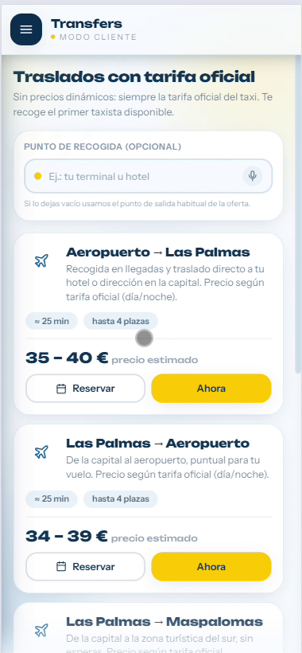

<div align="center">

# 🚕 TAYA

### La app de taxis de Gran Canaria

Pide, reserva y viaja por la isla con **rutas reales, tarifas oficiales y seguimiento en vivo**.
Pensada para clientes y taxistas, con tarificación según la ordenanza del taxi de
Las Palmas de Gran Canaria (BOC nº 150, 2023).


</div>

---

## 📱 Capturas (vista móvil)

<div align="center">

<table>
  <tr>
    <td align="center"><br/><sub><b>Bienvenida</b></sub></td>
    <td align="center"><br/><sub><b>Pedir taxi</b></sub></td>
    <td align="center"><br/><sub><b>Viaje en vivo</b></sub></td>
  </tr>
  <tr>
    <td align="center"><br/><sub><b>Transfers y excursiones</b></sub></td>
    <td align="center"><br/><sub><b>Reservas</b></sub></td>
    <td align="center"><br/><sub><b>Tarifa actual</b></sub></td>
  </tr>
  <tr>
    <td align="center"><br/><sub><b>Taxista · demanda</b></sub></td>
    <td align="center"><br/><sub><b>Taxista · avisos</b></sub></td>
    <td align="center"><br/><sub><b>Foro de taxistas</b></sub></td>
  </tr>
</table>

<sub>📷 ¿Faltan imágenes? Añádelas en <code>docs/screenshots/</code> — guía en
<a href="docs/screenshots/README.md">docs/screenshots/README.md</a>.</sub>

</div>

---

## ✨ Qué hace

TAYA conecta a **clientes** que necesitan un taxi con **taxistas** disponibles, en tiempo real,
en toda Gran Canaria. No es solo "pedir taxi": incluye reservas programadas, transfers y
excursiones de precio cerrado, foro de taxistas, estadísticas y un mapa de demanda.

### Para el cliente
- **Pedir taxi** escribiendo la dirección (autocompletado), **dictándola por voz** o tocando el mapa.
- **Ruta real por calles** (OSRM) con **tiempo estimado, km y precio** antes de pedir.
- **Seguimiento en vivo**: *taxi en camino → ha llegado (aviso) → en curso → completado*.
- **Transfers** (aeropuerto, sur…) y **excursiones** (Roque Nublo, vuelta a la isla…) a precio cerrado.
- **Reservas** para un día y hora concretos, con **contacto WhatsApp** al taxista.
- **Tarifa actual** visible en todo momento, **historial** de viajes y **estadísticas** de gasto.
- Contacto con el taxista desde el historial (por si te dejaste algo en el coche).

### Para el taxista
- **Mapa de demanda** por colores (roja/naranja/amarilla) según histórico de recogidas y **eventos**
  (partidos, conciertos, cruceros).
- Recibe solicitudes al instante (con sonido), acepta y gestiona el viaje paso a paso.
- **Reservas**: acepta carreras programadas; **campana de avisos** siempre visible (recordatorios,
  nuevas reservas, "ya tomada", "caducada").
- **Foro** de taxistas (chat de grupo en tiempo real).
- **Estadísticas** de ingresos y carreras; perfil y vehículo editables.

---

## 🧮 Sistema de tarifas (oficial LPGC, BOC nº 150 / 2023)

El precio se calcula **en tiempo real** según hora, día, festivos y zona:

| Franja | Bajada de bandera | €/km |
|---|---|---|
| Diurna laborable (6–22) | 2,95 € | 0,80 |
| Nocturna (22–6) y festivos/domingos | 3,65 € | 0,85 |
| 25-dic, 1 y 6-ene (9–22) | 4,30 € | 0,85 |

- La bajada de bandera incluye los **primeros 1.032 m**.
- **Tres zonas**: urbano (casco de Las Palmas), **Tarifa 3** (barrios periféricos: Tafira,
  Marzagán…) e **interurbano** (aeropuerto, sur, norte — km más caro por el retorno).
- **Festivos auto-mantenidos**: se siembran solos cada año con la **Semana Santa calculada**;
  los locales se pueden añadir a mano en la base de datos.

---

## 🏗️ Arquitectura

```
Navegador  ──http──>  Frontend (React + Vite)  ──REST/WebSocket──>  Backend (Spring Boot :8080)
http://localhost:5173                                                │
                                                                     ├──> PostgreSQL :5432  (datos)
                                                                     └──> Redis :6379       (taxis cercanos, GEORADIUS)

Servicios externos:  OSRM (rutas por calle) · Nominatim (direcciones)
```

| Capa | Tecnología |
|---|---|
| Frontend | React 18, Vite, Tailwind CSS, React Router, Leaflet (mapas) |
| Backend | Spring Boot 3.2.5, Java 17, Spring Security (JWT), JPA, WebSocket |
| Datos | PostgreSQL 16 (persistencia), Redis 7 (geolocalización en vivo) |
| Mapas/Geo | OSRM (rutas y distancia), Nominatim (geocodificación) |

**Tiempo real** vía WebSocket (`/ws`): estados del viaje, ubicación del taxi, foro, reservas.

---

## 🚀 Arranque rápido (local)

Requisitos: **Java 17**, **Node 18+**, **PostgreSQL 16**, **Redis 7**.
Guía detallada paso a paso (incluida instalación y pgAdmin): **[docs/RUN.md](docs/RUN.md)**.

```bash
# 1) Base de datos (o usa docker-compose up -d)
#    DB: taya_taxi  ·  user: taya_user  ·  pass: password

# 2) Backend  (o botón Play en IntelliJ)
cd backend && mvn spring-boot:run        # :8080

# 3) Frontend
cd frontend && npm install && npm run dev # :5173
```

Con Docker para la infra:

```bash
docker compose up -d        # PostgreSQL + Redis
```

### Usuarios de prueba
| Rol | Email | Contraseña |
|---|---|---|
| Cliente | `ana@taya.es` | `123456` |
| Taxista | `luis@taya.es` | `123456` |

---

## 📚 Documentación

- **[docs/RUN.md](docs/RUN.md)** — guía de instalación y arranque, tablas de la BD y datos de prueba.
- **[ROADMAP.md](ROADMAP.md)** — estado actual y aspectos de mejora.
- `docs/superpowers/` — spec y plan del MVP inicial (histórico).

---

## 🗺️ API (resumen)

Base: `/api` · Autenticación: JWT (`Authorization: Bearer …`)

| Área | Endpoints |
|---|---|
| Auth | `POST /auth/register`, `POST /auth/login` |
| Usuario | `GET/PUT /usuarios/me`, `PUT /usuarios/me/password` |
| Viajes | `POST /viajes/estimar`, `/solicitar`, `/solicitar-oferta`, `GET /viajes/activo`, `/{id}`, `/{id}/ruta`, `PUT /{id}/aceptar`·`llegada`·`iniciar`·`finalizar`·`cancelar` |
| Catálogo | `GET /catalogo` (transfers + excursiones) |
| Reservas | `POST /reservas`, `GET /reservas/mias`·`disponibles`·`taxista`, `PUT /reservas/{id}/aceptar`·`cancelar` |
| Tarifa | `GET /tarifa/actual` |
| Stats | `GET /stats/cliente`·`taxista`·`zonas` |
| Foro | `GET/POST /foro` |
| Taxistas | `GET /taxistas/cercanos`, `PUT /taxista/estado` |

---

## 🧱 Modelo de datos

`usuarios` · `viajes` · `reservas` · `mensajes_foro` · `eventos` (demanda) ·
`dias_festivos` · `configuracion_tarifa`. Detalle en [docs/RUN.md](docs/RUN.md).

---

<div align="center">
<sub>Hecho con ☀️ en Gran Canaria · Tarifas oficiales del taxi de Las Palmas de Gran Canaria.</sub>
</div>
